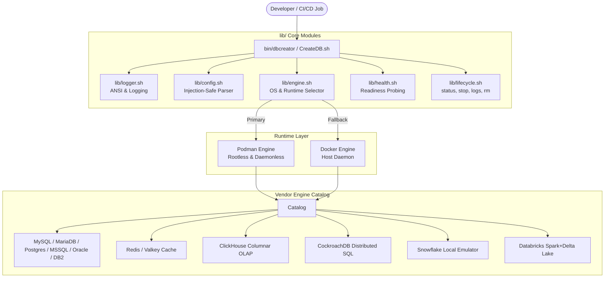

# Architecture & Design Blueprint: DatabaseCreator

**SPDX-License-Identifier:** Apache-2.0  
**Copyright:** (c) 2024-2026 Vivek Umrao and DatabaseCreator contributors.

---

## 1. Overview

DatabaseCreator is a modular, multi-vendor container orchestrator designed to provision local development, integration testing, and CI/CD database instances with zero manual setup. It adopts a **Podman-first, rootless design** with seamless fallback to **Docker**, decoupling the CLI front-end from individual database engine implementations.



---

## 2. Component Subsystems

### 2.1 CLI Frontend Layer (`bin/dbcreator` & `CreateDB.sh`)
- **`bin/dbcreator`**: The primary executable adhering to POSIX standards. Uses robust, order-independent parameter parsing (`while [[ $# -gt 0 ]]`).
- **`CreateDB.sh`**: Root-level wrapper delegating to `bin/dbcreator "$@"`. Ensures 100% backward compatibility for existing automation scripts, tutorials, and legacy callers.

### 2.2 Container Engine & OS Diagnostics (`lib/engine.sh`)
- **Host OS Detection**: Inspects `/etc/os-release` and kernel parameters, identifying OS families: `debian_like`, `rhel_like`, `arch_like`, `alpine`, `macos`, and `WSL2`.
- **Pre-Flight Audit**: Verifies Bash $\ge$ 4.0, POSIX utilities (`awk`, `sed`, `grep`, `cut`, `tr`, `mktemp`, `curl`), and container engines.
- **Engine Priority Resolution**:
  1. Checks for `podman` in `$PATH`.
  2. If absent, checks for `docker`. When fallback occurs, renders a warning banner with the exact package manager installation command for the detected OS.
  3. If both engines are absent, halts execution safely with status code 1 and outputs complete installation workflows.

### 2.3 Configuration & Secret Governance (`lib/config.sh`)
- **Exact Line-Anchored Property Extraction**: Replaces vulnerable substring grepping with exact boundary matching:
  ```bash
  awk -F '=' -v k="${key}" '$1 == k { sub(/^[^=]*=/, ""); gsub(/\r/, ""); print; exit }'
  ```
- **Password Integrity**: Preserves complex passwords containing equals signs (`=`), slashes (`/`), and ampersands (`&`) without string truncation or sed command injection.
- **Hierarchical Precedence**:
  1. Command-line flags (`-p`, `-n`, `-t`, etc.)
  2. Local environment override files (`Database.properties.local` or `config/database.env`)
  3. Version-controlled defaults ([Database.properties](file:///home/user/work/DatabaseCreator/Database.properties))

### 2.4 Health Probing & Fail-Fast Subsystem (`lib/health.sh`)
- **Non-Blocking Readiness Checks**: Replaces static, arbitrary delays (e.g. `sleep 60s`) with an iterative health inspection loop.
- **Fail-Fast Crash Detection**: Continuously inspects `.State.Running`. If the container crashes or exits prematurely during startup (`exited`, `dead`), the loop aborts immediately and surfaces the trailing container logs, preventing wasteful 10-minute timeouts.

### 2.5 Lifecycle Controller (`lib/lifecycle.sh`)
- Provides unified shorthand subcommands:
  - `dbcreator status [name]`: Inspect running instances.
  - `dbcreator logs [name]`: Stream container log output.
  - `dbcreator stop [name]`: Gracefully terminate container process.
  - `dbcreator rm [name]`: Cleanly tear down and remove container.

---

## 3. Storage Architecture & Persistent Volumes

By default, container filesystems write to an ephemeral copy-on-write overlay. DatabaseCreator provides persistent storage binding via `-d / --data-dir`:

| Engine | Internal Data Mount Path | Host Volume Recommendation |
| :--- | :--- | :--- |
| **MySQL / MariaDB** | `/var/lib/mysql` | Host directory or named volume |
| **PostgreSQL** | `/var/lib/postgresql/data` | Host directory with user write permissions |
| **Microsoft SQL Server** | `/var/opt/mssql` | Host directory |
| **Oracle Database Free** | `/opt/oracle/oradata` | Fast NVMe / SSD mount |
| **MongoDB** | `/data/db` | Host directory |
| **IBM DB2** | `/database` | Host directory |
| **Redis / Valkey** | `/data` | Host directory (AOF/RDB persistence) |
| **ClickHouse** | `/var/lib/clickhouse` | High-throughput disk volume |
| **CockroachDB** | `/cockroach/cockroach-data` | High-throughput distributed storage |
| **Snowflake Emulator** | `/data` | Host directory |
| **Databricks / Spark Delta** | `/opt/spark/data` | Parquet / Delta Lake storage directory |

When running with **Podman**, the flag `:Z` is automatically appended to volume mappings, instructing SELinux to configure container private unshared labels safely.

---

## 4. Security & Isolation Architecture

1. **Rootless by Default**:
   Podman maps the container's root user (`UID 0`) to an unprivileged subuid range on the host machine. If a container break occurs, the process has zero privileges on the host kernel.
2. **Elimination of Superuser Privileges**:
   The legacy `--privileged=true` flag has been stripped from all engine run commands.
3. **Hardened File Permissions**:
   All container scripts are created with `0755` (read/execute) and database SQL configuration files with `0644` (read-only for non-root).
4. **Sandboxed Build Isolation**:
   Temporary build directories are created in volatile memory using `mktemp -d` and are bound to an active POSIX `trap cleanup EXIT INT TERM`. Dangling build artifacts are never orphaned.
